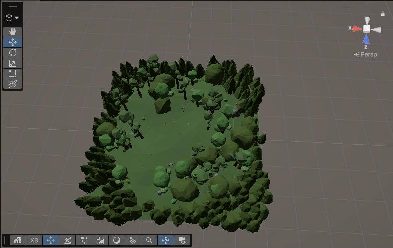
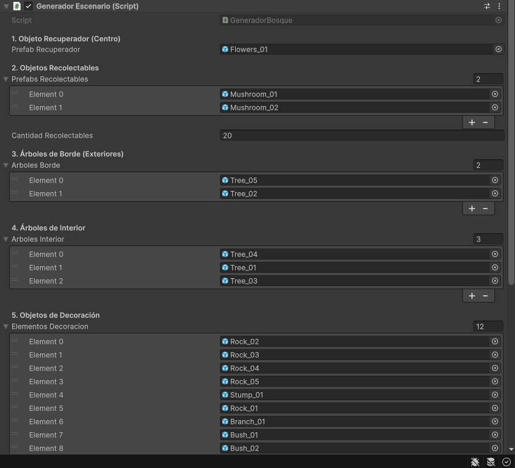

# Práctica Cardboard: recolectar con la vista en Unity

**Autor:** Iván Hernández Rodríguez  
**Asignatura:** Interfaces Inteligentes  
**Curso:** 4º  

Escena de realidad virtual para Google Cardboard en la que el jugador se desplaza inclinando la cabeza, recolecta setas manteniendo la mirada sobre ellas y las recupera mirando una flor especial. Se ha generado un `.apk` para Android y, como extra, un `.ipa` para iOS.

---

## 1. Requisitos de la práctica y cómo se han cumplido

| Requisito | Cómo se ha resuelto |
|---|---|
| Proyecto Cardboard con `.apk` para Android | Proyecto Unity 6 + Cardboard XR Plugin. APK generado desde Build Profiles. |
| Escena con objetos que se recolectan con la vista | Setas con tag `Recolectable`. Al mirarlas 1,5 s se recolectan. |
| Desplazamiento con la vista | Con la vista: al inclinar la cabeza hacia abajo más de 35°/45° el jugador camina hacia delante. |
| Terreno y objetos de la Asset Store | Terreno de Unity y modelos del paquete **Low-Poly Simple Nature Pack**. |
| Objeto que recupera los recolectados | Una flor con tag `Recuperador`. Al mirarla 1,5 s las setas recolectadas vuelan hacia el jugador. |
| Corregir el error de `CardboardStartup.cs` | Directiva de compilación `#if !UNITY_EDITOR` (ver sección 3). |
| Entrega: apk, scripts y README | Ver sección 9. |

---

## 2. Entorno

- **Unity:** 6000.6.6f1 (Unity 6)
- **Render pipeline:** Universal Render Pipeline (URP)
- **Paquetes:**
  - Google Cardboard XR Plugin for Unity 1.36.0 (instalado desde `https://github.com/googlevr/cardboard-xr-plugin.git`)
  - XR Plugin Management 4.7.0
  - Input System
  - Unity UI (uGUI), que incluye TextMeshPro
- **Asset Store:** Low-Poly Simple Nature Pack (modelos de setas, flores, rocas, arbustos y árboles).
- **Sistema de desarrollo:** Linux (Ubuntu).

---

## 3. Corrección del error de `CardboardStartup.cs`

Al ejecutar aparecía el error:

```
Please initialize Cardboard XR loader before calling this function.
UnityEngine.Debug:LogError (object)
```

Se producía porque `Api.UpdateScreenParams()` se llama en `Update()` aunque el loader de XR no esté inicializado, algo que ocurre en el editor. La solución fue envolver la llamada (línea 70) con una directiva de compilación, de modo que solo se compile en el dispositivo:

```csharp
#if !UNITY_EDITOR // Modificación
    Api.UpdateScreenParams(); // Línea en el código
#endif // Modificación
```

Para poder editar el script, se importó el sample **Hello Cardboard** desde el Package Manager, que copia el código a `Assets/Samples/`. Los scripts dentro de `Packages/` son de solo lectura.

---

## 4. Cómo se juega y controles

| Acción | Cómo se hace |
|---|---|
| Caminar | Inclinar la cabeza hacia abajo más de **45°** (y menos de 85°). El jugador avanza en la dirección de la mirada, en horizontal. |
| Recolectar una seta | Mirarla durante **1,5 segundos**. |
| Recuperar las setas | Mirar la **flor** central durante 1,5 segundos. Las setas aparecen en la flor y vuelan hacia el jugador. |

**Feedback visual:**

- Al mirar un objeto interactivo, se tiñe de **azul claro** y va pasando a **azul oscuro** según se completa el tiempo de mirada, como una barra de carga.
- Al recolectar o recuperar, se lanza un efecto de **partículas**.
- **Mirilla:** un pequeño cuadrado en el centro de la pantalla que invierte el color de lo que hay detrás.
- **Contador:** texto `SETAS x/20` con las setas recolectadas, en la parte inferior central de la pantalla.

Mientras se mira un objeto interactivo, el jugador **no camina**. Así, mirar una seta cercana desde un ángulo alto no desplaza al jugador.

---

## 5. Estructura de la escena

Escena principal: `PracticaCardboard` (copia de la escena `HelloCardboard` del sample).

```
PracticaCardboard
├── Sol                  (luz direccional)
├── Jugador              (ControladorVR + InterfazVR)
│   └── Main Camera
│       ├── CardboardReticlePointer
│       ├── Mirilla      (creada por InterfazVR)
│       └── HUD_Contador (creado por InterfazVR)
├── ArbolesBorde         (GeneradorEscenario)
├── Suelo                (terreno)
└── [setas y flor generadas por GeneradorEscenario]
```

- **Tags:** `Recolectable` (setas) y `Recuperador` (flor). Se asignan automáticamente durante la generación.
- **Colliders:** las setas y la flor tienen collider para que el raycast de la mirada las detecte.

---

## 6. Scripts

### `ControladorVR.cs`
Script principal, en el objeto `Jugador`. Se encarga de:

1. **Movimiento con la vista.** Si el ángulo X de la cámara supera `anguloInclinacionCaminar` (45°) y es menor de 85°, el jugador avanza en la dirección horizontal de la mirada.
2. **Selección por mirada.** Cada frame lanza un raycast desde la cámara hacia delante (`distanciaMaxSeleccion = 10`). Si impacta en un objeto interactivo, acumula tiempo de mirada.
3. **Recolección.** Al llegar a 1,5 s sobre un `Recolectable`, lo guarda en una lista, lo desactiva y lanza partículas.
4. **Recuperación.** Al llegar a 1,5 s sobre el `Recuperador`, reactiva las setas guardadas en la flor y las hace volar hacia el jugador con una corrutina (`MoveTowards`).
5. **Feedback de color.** Interpola del azul claro al azul oscuro con `MaterialPropertyBlock`, sin crear materiales nuevos.
6. **Contador.** Actualiza el texto `SETAS x/20`.
7. **Depuración en el editor.** Permite girar la cámara con el botón derecho del ratón (`Alt` + ratón). Este bloque está dentro de `#if UNITY_EDITOR`, así que no se compila en la build del móvil.

### `InterfazVR.cs`
Crea por código la interfaz al arrancar:

- La **mirilla**: un quad hijo de la cámara, sin collider, con el material `MatMirilla`.
- El **contador**: un Canvas en modo *World Space*, hijo de la cámara, con un texto TextMeshPro.

Se usa un Canvas en el mundo porque en VR estereoscópico un Canvas *Screen Space* no se ve.

### `GeneradorEscenario.cs`
Script encargado de la población procedimental del terreno por capas concéntricas (radios de distancia):

- **Asignación de categorías:** Permite definir los prefabs del objeto `Recuperador` (centro), objetos `Recolectables`, árboles de borde, árboles de interior y elementos decorativos (rocas, troncos, arbustos y hierba).
- **Asignación automática de Tags:** Asigna los tags `Recuperador` y `Recolectable` directamente en tiempo de instanciación.
- **Variación natural:** Aplica rotación aleatoria en el eje Y ($0^\circ$ a $360^\circ$) a cada elemento colocado y variaciones en la escala.
- **Zonas despejadas:** Mantiene un área limpia en el centro para el jugador y el objeto recuperador mediante raycasting hacia la capa `Suelo`.

#### Vista general del escenario generado procedimentalmente:


#### Objeto contenedor en la Jerarquía:


#### Componente configurado en el Inspector:


### `ReticleInvert` (shader) y `MatMirilla` (material)
Shader URP con modo de mezcla `Blend OneMinusDstColor Zero`, que calcula `1 - color de fondo`. Esto hace que el cuadrado de la mirilla invierta el color de lo que hay detrás. Incluye soporte de instanciado y estéreo para dibujarse bien en ambos ojos.

### `CardboardStartup.cs` (modificado)
Script del sample con la corrección de la sección 3.

---

## 7. Cómo se generaron el `.apk` y el `.ipa`

### Android (`.apk`)

1. Instalar el módulo **Android Build Support** (con OpenJDK y Android SDK & NDK Tools) desde Unity Hub.
2. En **XR Plug-in Management → Android**, marcar **Cardboard XR Plugin**.
3. En **Player → Android**:
   - Package Name: `com.ivan.cardboard`
   - Scripting Backend: IL2CPP
   - Target Architectures: ARM64
   - Default Orientation: **Landscape Left**
4. En **Build Profiles**, cambiar a Android, comprobar que `Build App Bundle` está **desmarcado** y pulsar **Build**.

### iOS (`.ipa`, extra)

Unity en Linux no puede compilar para iOS, así que solo genera el proyecto de Xcode y la compilación se hace en la nube:

1. Instalar **iOS Build Support** y marcar Cardboard en **XR Plug-in Management → iOS**.
2. En **Player → iOS** se configuró el Bundle Identifier y la **Camera Usage Description** (necesaria para escanear el QR del visor).
3. Con Unity se genera el proyecto de Xcode (**Build**).
4. Ese proyecto se sube a un repositorio de GitHub: <https://github.com/dvorak3/IntInt-Cardboard-IPA>.
5. Una **GitHub Action** (`.github/workflows/main.yml`) se ejecuta en un runner de macOS, compila con `xcodebuild archive` **sin firmar** y empaqueta el `.app` en una carpeta `Payload` comprimida como `.ipa`.
6. El `.ipa` se instala en el iPhone con **Sideloadly** usando un Apple ID gratuito.

---

## 8. Problemas encontrados y soluciones

| Problema | Causa | Solución |
|---|---|---|
| Error `Please initialize Cardboard XR loader` | `Api.UpdateScreenParams()` se llama sin XR inicializado en el editor | Directiva `#if !UNITY_EDITOR` |
| `TMPro` no encontrado al compilar | El script estaba en la carpeta del sample, que tiene un `.asmdef` sin referencia a TextMeshPro | Mover el script a `Assets/Scripts` |
| Mirar una seta no hacía nada | El collider estaba en un hijo (`Mushroom_01_LOD0`) y el tag en el objeto raíz | Método `BuscarInteractivo()`, que sube por los padres buscando el tag |
| Se caminaba al mirar objetos cercanos | Mirar un objeto a los pies superaba el ángulo de caminar | Subir el ángulo a 45° y no caminar mientras se mira un objeto interactivo |
| Un Canvas normal no se ve en Cardboard | Los Canvas *Screen Space* no se dibujan en VR estéreo | Canvas en modo *World Space*, hijo de la cámara |
| No se podía depurar en el editor | La cámara depende del visor | Giro con el ratón dentro de `#if UNITY_EDITOR` |
| Montón acumulado de árboles en el centro | Radio muy pequeño para la escala del terreno e interferencia de Raycast con la capa por defecto | Crear layer `Suelo` propia y ajustar los radios a 10, 26 y 46 unidades |

---

## 9. Contenido de la entrega

```
.
├── README.md
├── PracticaCardboard.apk
├── Scripts/
│   ├── ControladorVR.cs
│   ├── InterfazVR.cs
│   ├── GeneradorEscenario.cs
│   ├── CardboardStartup.cs
│   └── ReticleInvert.shader
└── Capturas/
    ├── escenario-generado.png
    ├── generador-inspector.png
    ├── arboles-borde-hierarchy.png
    ├── 01-mirada-carga.png
    ├── 02-recoleccion-particulas.png
    └── 03-recuperacion-flor.png
```

---

## 10. Capturas

**1. Generación de Escenario procedimental.** Vista superior del mapa con árboles distribuidos por radios, decoración aleatoria y zona central libre.


**2. Jerarquía del proyecto.** Contenedor `ArbolesBorde` listo para almacenar todos los objetos instanciados.


**3. Inspector del script `GeneradorEscenario`.** Configuración de listas de prefabs, radios de generación y capa de suelo.


---

## Créditos

- **Google Cardboard XR Plugin** y sample *Hello Cardboard* (Apache License 2.0).
- Modelos 3D: Low-Poly Simple Nature Pack.
